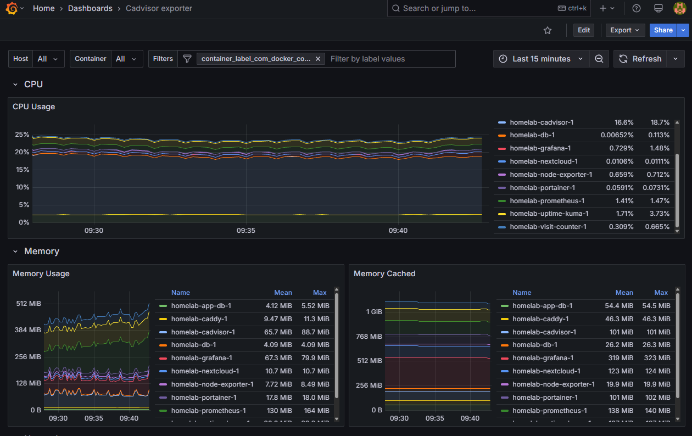
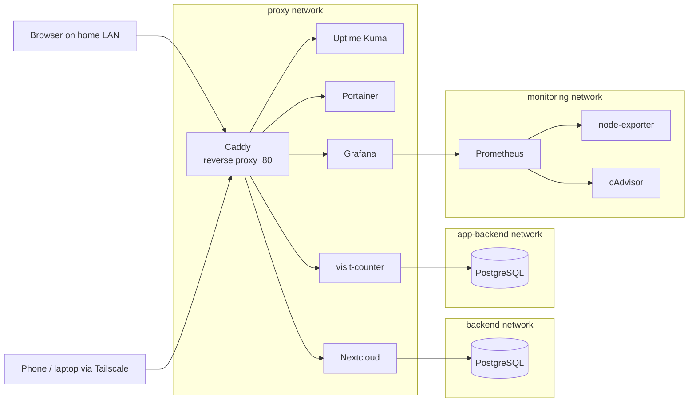

# Homelab

A self-hosted Linux server running 11 Dockerized services, built to learn Docker, networking and server operations hands-on. Everything is defined in a single Docker Compose file and runs on an old laptop at home.



## Hardware

| | |
| --- | --- |
| Machine | Dell Inspiron 15-3567 (4 threads, ~3.5 GB RAM, 1 TB HDD) |
| OS | Ubuntu Server 26.04 LTS |
| Runtime | Docker 29 + Docker Compose |
| Network | Wi-Fi over Starlink, TP-Link Deco mesh |

## Architecture



- **Caddy is the only container with a published port.** Every other service is reachable only through it.
- **Each service gets its own hostname** via nip.io (`kuma.<ip>.nip.io`, `grafana.<ip>.nip.io`, ...) instead of a port number.
- **Databases live on isolated internal networks.** Caddy cannot reach them; only the app that owns each database can.
- **Each app has its own database**, so a failure or compromise in one doesn't affect the other.

## Services

| Service | Purpose |
| --- | --- |
| Caddy | Reverse proxy, routes each hostname to its service |
| Uptime Kuma | Uptime monitoring |
| Portainer | Docker management UI |
| Nextcloud + PostgreSQL | Private file cloud |
| visit-counter + PostgreSQL | My own FastAPI app, deployed automatically from GitHub |
| Prometheus | Collects and stores metrics every 15 seconds |
| node-exporter | Host metrics: CPU, memory, disk, network |
| cAdvisor | Per-container metrics |
| Grafana | Dashboards on top of Prometheus |

## CI/CD

The [visit-counter](https://github.com/Muller5258/visit-counter) app has its own repository:

1. Every push to `main` triggers GitHub Actions
2. The image is built with a multi-stage Dockerfile and pushed to GHCR
3. `deploy.sh` runs on the server every 5 minutes via cron, pulls the image and replaces the container only if it changed
4. Data survives every deployment in a Docker volume

## Monitoring

Prometheus scrapes node-exporter (host) and cAdvisor (containers). Grafana shows two dashboards: Node Exporter Full (1860) for the server and Cadvisor exporter (14282) for each container.

## Security

- SSH key-only login; password authentication disabled
- UFW firewall
- Secrets in `.env`, never committed (see `.env.example`)
- App containers run as a non-root user
- Image versions pinned where `latest` caused problems
- Remote access through Tailscale; no ports opened on the router

## Lessons learned

Things that broke along the way, and how I fixed them:

- **SSH config override:** Disabling password login had no effect at first. A cloud-init file in `sshd_config.d/` overrode the main config; editing it and verifying with `sshd -T` fixed it.
- **Empty config file:** Caddy kept restarting with an `EOF` error. A typo in the filename meant the real `Caddyfile` was empty.
- **Browser HTTPS-first:** Typing a hostname without `http://` made Chrome try HTTPS, which timed out. Always use the full URL for plain-HTTP services.
- **Portainer setup token:** Newer Portainer versions need a one-time token from the container logs before the admin user can be created.
- **Special characters in passwords:** A base64 password containing `/` broke the PostgreSQL connection URL. Passwords that go inside URLs are now hex-only.
- **Corrupted image layer:** Pulling `grafana/grafana:latest` kept failing on one layer. Pinning to `11.6.0` fixed it, and pinned versions also prevent surprise breaking updates.
- **Docker 29 storage change:** cAdvisor v0.49 couldn't read containers after Docker 29 switched to the containerd image store. Found it in the logs; upgrading to v0.56 (now on ghcr.io) fixed it.
- **Network migration:** Switching ISP to Starlink changed the server's subnet. Container-to-container traffic kept working because it uses service names; only hardcoded IPs (Caddyfile, `.env`, Nextcloud trusted domains, netplan Wi-Fi config) needed updating.
- **Stale config after file replace:** Caddy kept serving an old Caddyfile after the file was replaced. Recreating the container (`docker compose up -d --force-recreate caddy`) picks up the new file reliably.

## Setup

```bash
git clone git@github.com:Muller5258/homelab.git
cd homelab
cp .env.example .env    # fill in values
docker compose up -d
```

`prometheus.yml` and `Caddyfile` are in the repo; update the IP addresses in `Caddyfile` for your network.
